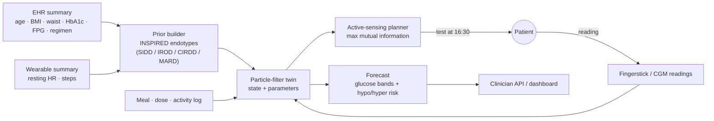
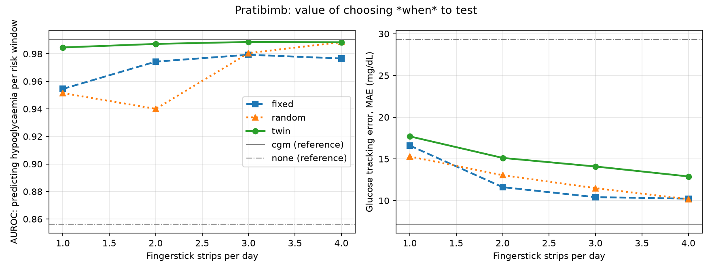

# Pratibimb (प्रतिबिंब) — a metabolic digital twin that decides when to test

**Digital Twin Challenge 2026 · Happiest Health**
India-calibrated Type 2 Diabetes twin that fuses an EHR summary with sparse fingerstick (or CGM)
and wearable data, forecasts glucose with uncertainty, and **tells the patient *when* to prick
their finger** so a small strip budget reveals the most about upcoming hypoglycaemia risk.

> ⚠️ Research prototype. Not a medical device. No dosing advice. See [MODEL_CARD.md](MODEL_CARD.md).

| | |
|---|---|
| **Team** | _TODO: team name, members, roles_ |
| **College / incubator** | _TODO_ |
| **Video (2–5 min)** | _TODO: unlisted YouTube link_ |
| **Architecture diagram** | _TODO: `docs/architecture.pdf`_ |
| **Presentation** | _TODO: `docs/presentation.pdf`_ |
| **Licence** | Apache-2.0 ([LICENSE](LICENSE), [NOTICE](NOTICE)) |

---

## 1. Problem and healthcare use case

India has ~101 million people with diabetes (ICMR-INDIAB-17). Sulfonylureas are cheap and widely
prescribed, and they cause hypoglycaemia that is frequently **nocturnal and asymptomatic**
(Middleton et al., *Diabetes Care* 2017: 67% nocturnal, 73% asymptomatic). A CGM would reveal it,
but a sensor costs ₹4,200–5,250 per 14 days (≈ ₹9,000/month), so most patients rely on a few
fingersticks taken at habitual times (fasting, 2-h post-breakfast) that rarely coincide with risk.

**Question:** if a patient can afford only 1–4 strips a day, *when* should they test?

**Use case:** a doctor enrolls a patient from the EHR (age, BMI, waist, HbA1c, fasting glucose,
regimen). The twin starts from an India-specific physiological prior, learns the patient's own
insulin sensitivity, basal glucose and sulfonylurea response from each reading, and each morning
recommends the most informative testing times. At bedtime it reports overnight hypoglycaemia risk
with an uncertainty band.

## 2. Why this is a digital twin (NASEM 2023 definition)

| NASEM element | Pratibimb |
|---|---|
| Virtual representation of a specific patient | 10-state glucose–insulin–gut–drug model with 6 patient-specific parameters |
| Dynamically updated from the physical twin | Joint state/parameter particle filter assimilates every reading (SMBG or CGM) |
| Predictive capability | Posterior-predictive glucose trajectories and event probabilities |
| Informs decisions | Active-sensing planner (when to test), overnight risk at bedtime |
| Two-way flow | The twin *requests* data from the patient (test at 16:30) and updates on what it receives |
| VVUQ | Unit-tested physics, known-truth evaluation, bootstrap CIs, heavy-tailed likelihood, full audit log |

## 3. How it works



1. **Physiology** (`pratibimb/physiology/model.py`): extended Bergman minimal model with fast/slow
   carbohydrate absorption (GI- and food-order-aware), sulfonylurea PK/PD (glucose-independent
   insulin secretion, the hypoglycaemia mechanism), metformin, exercise, circadian insulin
   sensitivity, dawn phenomenon and sleep-blunted counter-regulation. Vectorised RK4.
2. **India-specific prior** (`cohort/endotypes.py`): soft assignment to the four INSPIRED Indian T2D
   endotypes (n = 19,084) → moment-matched log-normal prior; HOMA-IR and HOMA-B per endotype seed
   insulin sensitivity and beta-cell/SU response.
3. **Data assimilation** (`twin/particle_filter.py`): joint state/parameter particle filter,
   Student-t likelihood (robust to bad readings), Liu–West resampling, slow drift of insulin
   sensitivity, basal glucose and SU response.
4. **Active sensing** (`sensing/planner.py`): chooses reading times that maximise
   `Σ_w weight_w · I(Y_S ; hypo in window w)`, estimated by nested Monte Carlo over the twin's own
   forecast ensemble; greedy, re-planned after every reading; readings count only for risk calls
   made after them (e.g. the bedtime overnight decision).
5. **Event-sourced engine + API** (`twin/engine.py`, `api/`): every input is an immutable event;
   late data trigger deterministic replay; the full record is exportable for audit.

## 4. Results — strip-budget experiment

40 sulfonylurea-treated virtual Indian patients (HbA1c ≤ 8%), 7 evaluation days each, 1,120 risk
windows. At the start of each window (morning, afternoon, evening, and night at 22:30 bedtime) the twin
predicts P(glucose < 70 mg/dL for ≥ 15 min). Same truth, logs, meter noise and filter seed for
every policy. Full table: [`results/strip_budget/summary.md`](results/strip_budget/summary.md).



| Strip budget | Policy | Strips actually used/day | AUROC | Brier ↓ | Sensitivity @ p≥0.2 |
|---|---|---|---|---|---|
| 1 | Fixed (fasting) | 1.0 | 0.954 | 0.0251 | 0.72 |
| 1 | **Twin-scheduled** | **0.8** | **0.985** | **0.0167** | **0.79** |
| 2 | Fixed (FBS + PPBS) | 2.0 | 0.974 | 0.0223 | 0.81 |
| 2 | **Twin-scheduled** | **1.4** | **0.987** | **0.0165** | **0.85** |
| — | CGM every 15 min (reference) | 65 | 0.990 | 0.0153 | 0.81 |
| — | No readings (prior + logs) | 0 | 0.856 | 0.0368 | 0.19 |

**Findings.** Twin-scheduled testing improves hypoglycaemia risk prediction over the standard
fasting / post-breakfast schedule at every budget. The paired, patient-level bootstrap Brier
improvement excludes zero at every budget: at 1 strip it is +0.008 [95% CI +0.002, +0.016]. The twin
also uses *fewer* strips: it skips readings that would not change the risk estimate. **Under one
strip a day, its risk prediction comes close to a CGM's.**

**Trade-off.** The planner optimises information about *hypoglycaemia*, not general glucose tracking.
Mean tracking error is higher than the fixed schedule's (e.g. 14.1 vs 10.4 mg/dL at a budget of 3).
The objective can be re-weighted toward time-in-range if a clinician wants that instead.

**Limitations.** Read these before quoting any number:
1. Hypoglycaemia was rare in this cohort: only **5 of 40 patients** had any low window, 47 events in
   total. AUROC therefore mainly reflects *who* is at risk, and the evidence rests on few patients.
2. The data are synthetic. The twin and the simulator share model structure, though the simulator
   deliberately adds mismatch.
3. Night-time lows are under-represented in the synthetic cohort (see DATA.md).
4. Real-data validation (ShanghaiT2DM) is the next milestone.

## 5. Quick start

```bash
uv sync --all-extras          # Python 3.11+, installs deps into .venv
uv run pytest                 # 29 tests: physiology, endotypes, filter, planner, engine, API
uv run python scripts/demo_day.py                     # one simulated day through the HTTP API
uv run uvicorn pratibimb.api.app:app --reload         # API + interactive docs at /docs
uv run pratibimb-strip-experiment --patients 40 --days 7 --workers 8   # reproduce results
```

Docker: `docker build -t pratibimb . && docker run -p 8000:8000 -v twins:/data/twins pratibimb`

### API (OpenAPI docs at `/docs`)

| Method | Path | Purpose |
|---|---|---|
| `POST` | `/v1/twins` | Create a twin from an EHR profile (returns endotype probabilities + prior) |
| `POST` | `/v1/twins/{id}/events` | Ingest glucose (SMBG/CGM), meals, medications, activity |
| `GET` | `/v1/twins/{id}/state` | Current glucose estimate + posterior physiology vs prior |
| `POST` | `/v1/twins/{id}/forecast` | Glucose quantile bands and hypo/hyper risk; optional what-if meals |
| `POST` | `/v1/twins/{id}/fingerstick-plan` | Recommended testing times for a strip budget |
| `GET` | `/v1/twins/{id}/record` | Full event log (audit; replays deterministically) |
| `DELETE` | `/v1/twins/{id}` | Erase a twin (DPDP right to erasure) |

Configuration: `PRATIBIMB_API_KEY` (require `X-API-Key`), `PRATIBIMB_DATA_DIR` (persist event logs),
`PRATIBIMB_CORS_ORIGINS`. All timestamps must carry a timezone (e.g. `+05:30`).

## 6. Technical stack

Python 3.11 · NumPy (vectorised ODE + particle filter + information-theoretic planner) ·
FastAPI + Pydantic v2 · uv · pytest · ruff · GitHub Actions · Docker. No deep-learning
framework is needed for the core; the model is small, interpretable and fast.

## 7. Data, privacy and regulation

- Only synthetic and open data; no clinical data in the repo ([DATA.md](DATA.md)).
- Designed toward the DPDP Act 2023 / Rules 2025: data minimisation (no names or identifiers in
  the profile), erasure endpoint, full audit trail. Consent management is out of scope for v0.1.
- CDSCO's Draft Guidance on Medical Device Software (21 Oct 2025) would classify a clinical version
  as SaMD; this prototype makes no clinical claims.

## 8. Roadmap

- [ ] Real-data validation on ShanghaiT2DM (`scripts/download_data.py shanghai`) and CGMacros
- [ ] Conformal calibration of forecast bands; calibration plots
- [ ] Clinician dashboard (triage, AGP, forecast, strip planner, what-if thali simulator)
- [ ] Mechanistic DPP-4i / SGLT2i effects; fasting-day (vrat / Ramadan) scenario
- [ ] ABDM FHIR R4 import of the EHR profile

## References

Key sources are cited inline and in `research/Pratibimb_Research_Brief_v2.md`.
